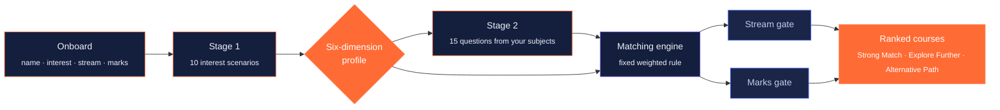
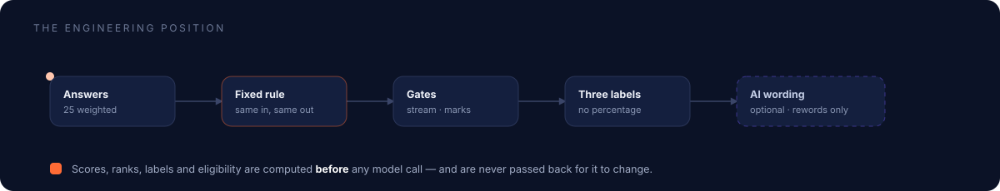

<div align="center">



<br/>

<a href="#"></a>
<a href="#"></a>
<a href="#"></a>
<a href="#"></a>
<br/>
<a href="#"></a>
<a href="#"></a>
<a href="#"></a>

<br/><br/>

### **Branch Predictor** — because in Indian college-speak, your *branch* is your future.

A career-discovery app for **PU students in Karnataka** that shows its working
instead of handing down a verdict.

</div>

---



---



## Why this exists

Most PU students pick a degree on the advice of relatives, coaching centres and
guesswork. Most career quizzes answer them with a black box and a confident
**"92% match"**.

A ten-question quiz cannot honestly know that. So this one does not pretend to.

> **The rule this project is built on:** every recommendation shows the reasoning
> that produced it, eligibility is a gate rather than a flattering bonus, and no
> number is invented to sound precise.

---

## How it works



**Stage 1 — ten scenarios, no wrong answers.** Grounded in a real student's week:
a free Sunday after exams, a dead table fan, a group project due Monday. Each
option carries weights across six interest dimensions.

**Stage 2 — fifteen questions from the student's own subjects.** These *do* have
a right answer, five from each of three PU subjects. A correct answer lights an
emoji path; a wrong one gets an explanation, never a scold. **No score is ever
shown.**

**The match.** Interest overlap decides the ranking. Stream eligibility and marks
band sit on separate axes — they can flag a course as a stretch, but they never
hide it and never alter its rank.

---



## What a student gets

| | |
|---|---|
| **Six interest dimensions** | technology · creativity · engineering · business · communication · analytical |
| **Seven archetypes** | from *The Digital Innovator* to *The Curious Explorer* |
| **12 real UG programmes** | the actual courses offered by **NCET** and **NCMS**, not a stock list |
| **20 career pages** | day-in-the-life, skills, and the courses that lead there |
| **Side-by-side compare** | duration, eligibility, skills and routes for any two courses |
| **Grounded mentor** | answers from the catalogue; the optional AI layer only rewords |
| **PDF export** | a profile a student can take home to a parent |

---



## For educators

> Put **one code on the board.** The class joins — no accounts, no emails,
> nothing to install.

Aggregated dashboards show interest distribution, course demand and the students
still undecided. **Individual answers are never exposed by default.**

---



## The engineering position

<table>
<tr><td width="50%" valign="top">

**Rules, not vibes**

Scoring is a fixed weighted formula over six dimensions. The same answers always
produce the same result. No model decides a rank.

</td><td width="50%" valign="top">

**The AI layer only rewords**

Scores, ranks, labels and eligibility are computed *before* any provider call and
are never passed back for a model to change. The deterministic answer is the
fallback on every failure path.

</td></tr>
<tr><td width="50%" valign="top">

**Local-first**

No accounts, no emails, no student records on a server by default. The whole
journey runs in the browser.

</td><td width="50%" valign="top">

**One token system, two themes**

`midnight` is the *ink* token, not a surface — it flips to near-white in dark
mode and carries 250+ usages with it. Light is the default.

</td></tr>
</table>

---

## Stack

```
Next.js 16 (App Router · Turbopack · cacheComponents)
React 19  ·  TypeScript strict  ·  Tailwind CSS v4 (CSS-first tokens)
Framer Motion  ·  GSAP (analysis sequence only)  ·  Recharts
Zustand + persist  ·  Zod  ·  jsPDF
```

---

## Run it

```bash
npm install
npm run dev          # http://localhost:3000
```

Everything works with **no API key**. To enable the optional AI wording layer:

```bash
cp .env.example .env.local
# add any OpenAI-compatible endpoint + key
```

---


<div align="center">

<sub>Built for PU students in India. Recommendations are guidance, not admission guarantees.</sub>

</div>
